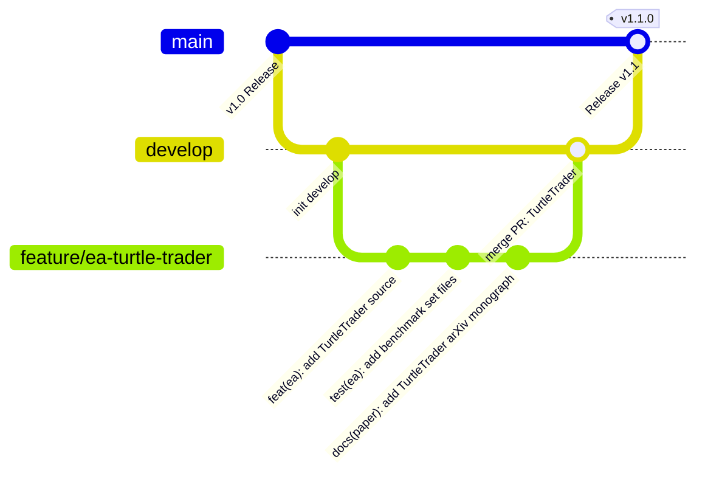

# 🤖 Berrytrade-EA: AI Agent Governance & Operational Guidelines

> **Target Audience**: AI Coding Assistants (Antigravity, Gemini, Claude, Copilot, etc.) and Quant Developers  
> **Repository**: `Berrytrade-EA`  
> **Branching Model**: Strict GitFlow (`main`, `develop`, `feature/*`)  
> **Lead Researcher**: Berry Wahlberg (`Berrytrade Quantitative Research, Singapore`)

---

## 1. Core Mission & Scope

**Berrytrade-EA** is an institutional-grade open-source quantitative trading repository for MetaTrader 5 (MQL5). The project's goal is to bridge the gap between misleading retail backtest marketing and institutional-grade, execution-constrained empirical reality.

Every automated strategy in this repository must undergo:
1. Strict MQL5 source code sanitation (zero native Win32 DLLs).
2. Continuous 3-year execution-constrained backtesting (2023.01.01 to 2025.12.31) under realistic latency (120ms), floating spreads, and commissions ($7/lot).
3. 6 publication-grade diagnostic figures (Nature/Science 300 DPI style).
4. A dedicated, standalone academic research paper in LaTeX + BibTeX formatted for arXiv quantitative finance publication.

---

## 2. Security Boundaries & Proprietary Asset Protection (STRICT)

> [!CAUTION]
> **ABSOLUTE PROHIBITION ON PROPRIETARY LOCAL ASSETS**  
> `F:\dev\Berrytrade_onlyme` is a private, proprietary, closed-source algorithmic trading asset owned solely by the user.  
> Under **NO CIRCUMSTANCES** should any AI agent read, scan, index, copy, list, or reference files located in `F:\dev\Berrytrade_onlyme` or any other local non-open repository.

### Source Ingestion Policy
- All new strategies must originate strictly from **public, open-source repositories on the Internet** (e.g., GitHub, MQL5 CodeBase, GitLab, or published academic literature).
- Always verify that the open-source license allows redistribution and modification (MIT, Apache 2.0, GPL, BSD, etc.).
- Clearly cite the original author and open-source provenance in `README.md` and `metadata.json`.

---

## 3. GitFlow Branching & Commit Workflow

All agent actions must adhere to the GitFlow branching standard with **frequent, small, atomic commits**:



### 3.1 Branching Rules
- **`main`**: Production & release branch. Never commit directly to `main`.
- **`develop`**: Integration and staging branch. All feature branches originate from and merge back into `develop`.
- **`feature/<name>`**: Dedicated feature branches (e.g. `feature/ea-turtle-trader`, `feature/docs-update`).
- **`fix/<name>`**: Bug fixes or parameter adjustments.

### 3.2 Commit Policy ("小步PR，频繁commit")
- Never bundle multiple unrelated tasks into a single massive commit.
- Keep commits small, atomic, and self-contained.
- Follow [Conventional Commits](https://www.conventionalcommits.org/):
  - `feat(ea)`: Adding a new strategy codebase or trading logic.
  - `test(ea)`: Adding backtest reports, `.set` presets, or benchmark metrics.
  - `docs(papers)`: Updating LaTeX research papers or bibliographies.
  - `docs(repo)`: Updating Readme, architecture, or Wiki guides.
  - `ci`: Updating GitHub workflows or automated verification tools.

---

## 4. The 5-Stage Strategy Ingestion Pipeline

When ingesting an open-source Expert Advisor from the Internet, the AI agent must execute this exact 5-stage pipeline:

```text
[Stage 1: Source & Security Audit]
   └── Check open-source license
   └── Strip any native Win32 DLLs (#import "user32.dll", "kernel32.dll", etc.)
   └── Enforce English-only code, variable names, and comments

[Stage 2: Standardized MQL5 Architecture]
   └── Implement standard inputs: InpMagicNumber, InpSlippagePoints, InpRiskPercent, InpStopLossPoints
   └── Enforce dynamic lot sizing with broker symbol constraints (SYMBOL_VOLUME_MIN, STEP)
   └── Mandatory hard Stop-Loss calculation on order execution
   └── Save parameter presets into presets/default.set and presets/conservative.set

[Stage 3: 3-Year Institutional Benchmark Backtest]
   └── Period: 2023.01.01 -- 2025.12.31
   └── Execution constraints: 120ms latency, floating spreads, $7.00/lot commission
   └── Extract: Net Profit, Max Equity Drawdown, Profit Factor, Min Margin Level
   └── Generate reports/summary.json and metadata.json

[Stage 4: 6 Nature/Science Diagnostic Figures (300 DPI)]
   └── fig1: Equity vs Balance Divergence ("Scissors Gap")
   └── fig2: Drawdown Depth & Duration Waterfall
   └── fig3: Trade Holding Time vs Realized PnL Scatter
   └── fig4: Monte Carlo 1,000 Order Permutation Distribution
   └── fig5: Rolling 30-Day Sharpe Ratio & Realized Volatility
   └── fig6: MFE vs MAE Trajectory Scatter

[Stage 5: Standalone arXiv Research Monograph]
   └── Authored by Berry Wahlberg (Berrytrade Quantitative Research)
   └── Derive mathematical indicator difference/differential equations
   └── Conduct Bailey & Lopez de Prado Deflated Sharpe Ratio (DSR) audit
   └── Include local references.bib (28+ authoritative literature citations)
   └── Compile via 4-pass pdflatex + bibtex pipeline (zero undefined citation warnings)
```

---

## 5. Quality Gates & Validation Checklist

Before submitting a Pull Request or merging a feature branch into `develop`, the agent must verify:

1. **Automated EA Validation**:
   ```powershell
   python tools/validate_ea.py
   ```
   *Pass criteria: 100% pass across all strategies (structure, presets, reports, metadata, no DLLs).*

2. **Catalog Synchronization**:
   ```powershell
   python tools/generate_catalog.py
   ```

3. **LaTeX / BibTeX Compilation Integrity**:
   ```powershell
   python tools/build_deep_research_papers.py
   ```
   *Pass criteria: All strategy papers compile cleanly with `.bbl` generated and zero `Citation undefined` warnings.*

4. **Git Tree Cleanliness**:
   ```powershell
   git status
   ```
   *Pass criteria: Working tree clean, all temporary auxiliary files (.aux, .out, .toc, .log) safely ignored.*

---

## 6. Open-Source Ingestion Order of Precedence

The current active research campaign follows this priority order:
1. **`TurtleTrader`** (Richard Dennis & William Eckhardt Donchian Breakout, N-volatility lot sizing, 2N trailing stop) &mdash; **[COMPLETED]**
2. **`LondonBreakout`** (Asian session range definition, Frankfurt/London open liquidity breakout, zero overnight carry) &mdash; **[COMPLETED]**
3. **`SMC_FVG`** (Smart Money Concepts / ICT Fair Value Gap, Liquidity Sweep & Order Blocks) &mdash; **[COMPLETED]**
4. **`StatArbPairs`** (Cointegrated statistical arbitrage pairs trading, EURUSD vs GBPUSD) &mdash; **[COMPLETED]**
5. **`KalmanFilterEA`** (State-space adaptive filtering, real-time drift estimation) &mdash; **[COMPLETED]**
6. **`HMMRegimeEA`** (Hidden Markov Model Gaussian Mixture Volatility Regime Switching Filter) &mdash; **[COMPLETED]**
7. **`OrderFlowImbalanceEA`** (Microstructure order book Bid-Ask delta imbalance and tick volume absorption) &mdash; **[COMPLETED]**
8. **`VolBreakoutATR`** (Parkinson / Garman-Klass extreme-value volatility breakout with expansion triggers) &mdash; **[CURRENT TASK]**
9. **`CrossSectionalMomentum`** (Multi-currency basket cross-sectional relative strength momentum) &mdash; **[QUEUED]**
10. **`MeanRevertingOU`** (Continuous-time Ornstein-Uhlenbeck drift filtration with analytical half-life) &mdash; **[QUEUED]**
9. **`CrossSectionalMomentum`** (Multi-currency basket cross-sectional relative strength momentum) &mdash; **[QUEUED]**
10. **`MeanRevertingOU`** (Continuous-time Ornstein-Uhlenbeck drift filtration with analytical half-life) &mdash; **[QUEUED]**
