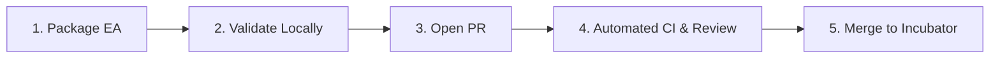

# 🤖 Berrytrade-EA

<p align="center">
  <strong>Institutional-Grade Open-Source Expert Advisors (EAs) & Quantitative Backtesting Framework for MetaTrader 5 (MQL5)</strong>
</p>

<p align="center">
  <a href="README.md"><strong>English</strong></a> | 
  <a href="README.zh-CN.md"><strong>简体中文</strong></a>
</p>

<p align="center">
  
  
  
  
  
</p>

---

## 📖 Overview

**Berrytrade-EA** is an open-source initiative dedicated to engineering high-quality, transparent, and reproducible algorithmic trading strategies (Expert Advisors) for **MetaTrader 5 (MT5)**.

Unlike traditional repositories that accumulate uncurated `.mq5` files without parameters or risk audits, **Berrytrade-EA** enforces:
- **Modular Packaging**: Every EA is a self-contained unit with source code, `.set` parameter presets, backtest reports, and structured metadata.
- **Strict Risk Governance**: Mandatory hard Stop-Loss enforcement. High-risk mechanics (such as Martingale or Uncapped Grid) are strictly quarantined and flagged.
- **Two-Tier Quality Funnel**: Community submissions enter `experimental/` for incubation, and graduate to `verified/` after passing standardized multi-year benchmark audits.
- **Automated Security CI**: Automated scanning prevents malicious Win32 DLL calls, telemetry backdoors, and broken schemas.

---

## 📊 Strategy Catalog

The catalog below is dynamically generated from strategy `metadata.json` files:

### Verified Strategies (Production-Grade)

*No strategies currently in this tier.*

### Experimental Strategies (Incubator & Community)

| Strategy | Category | Risk Level | Symbols | TF | Min Cap | Summary |
| :--- | :--- | :---: | :--- | :---: | :---: | :--- |
| [TemplateEA](strategies/experimental/TemplateEA) | `trend_following` | **Low** | XAUUSD, EURUSD | M5 | $1,000 | Standardized MQL5 EA template showcasing risk management, hard stop-loss, and modular structure. |

---

## 🏗️ Repository Architecture

```text
Berrytrade-EA/
├── .github/                       # GitHub workflows, Issue & PR templates
├── docs/                          # Multi-language documentation (I18N ready)
│   ├── en/                        # English documentation (Primary)
│   └── zh-CN/                     # Chinese documentation (Secondary)
├── strategies/                    # Self-contained EA packages
│   ├── verified/                  # Audited & benchmarked strategies
│   └── experimental/              # Community submissions & research models
│       └── <StrategyName>/
│           ├── src/               # EA source code (.mq5)
│           ├── presets/           # MT5 .set parameter presets
│           ├── reports/           # Backtest summary & tester reports
│           ├── metadata.json      # Machine-readable specification
│           └── README.md          # Strategy documentation
├── shared/                        # Shared libraries and reusable headers
│   ├── Include/Berrytrade/        # Namespaced risk & order utilities
│   ├── Indicators/                # Common technical indicators
│   └── Scripts/                   # Helper scripts
├── benchmarks/                    # Standardized testing environments & datasets
│   └── standards.json             # Baseline broker constraints (spreads, slippage)
├── tools/                         # Dev tools, CI linters, MT5 sync scripts
│   ├── validate_ea.py             # Linter & metadata validator
│   ├── generate_catalog.py        # Automated README catalog generator
│   └── sync_to_mt5.ps1            # Sync / symlink repo into MT5 terminal
├── CONTRIBUTING.md                # Contributor guide entry point
├── LICENSE                        # MIT License
└── README.md                      # Primary project homepage
```

For more architectural details, see [Architecture Documentation](docs/en/architecture.md).

---

## 🚀 Quick Start: Deploying to MetaTrader 5

To install Berrytrade strategies and shared libraries into your local MT5 Terminal:

```powershell
# Run the deployment sync script
powershell ./tools/sync_to_mt5.ps1 -MT5DataPath "<YOUR_MT5_DATA_PATH>"
```

*Note: Your MT5 Data Directory can be found inside MetaTrader 5 by selecting **File -> Open Data Folder**.*

---

## 📥 EA Ingestion & Contribution Process

We welcome pull requests from traders and developers. All submissions must follow our four-step onboarding process:



1. **Package your EA**: Place your files in `strategies/experimental/<YourStrategyName>/` adhering to the required structure:
   - `src/<YourStrategyName>.mq5`
   - `presets/<PresetName>.set`
   - `reports/summary.json`
   - `metadata.json`
   - `README.md`
2. **Run Local Validation**:
   ```powershell
   python tools/validate_ea.py --path strategies/experimental/<YourStrategyName>
   ```
3. **Submit a Pull Request**: Use the repository's [PR Template](.github/PULL_REQUEST_TEMPLATE/pull_request_template.md) and ensure all checklist items are completed.
4. **Detailed Specifications**:
   - [EA Ingestion & Review Specification](docs/en/ea-ingestion-specification.md)
   - [Contribution Guidelines](docs/en/contribution-guidelines.md)

---

## 🚨 Risk Disclaimer

**USE AT YOUR OWN RISK:** Trading financial instruments, forex, metals, and CFDs carries a high level of risk and may not be suitable for all investors. Leverage can work against you as well as for you.

- **Not Financial Advice**: The contents, strategies, indicators, and software in this repository are for educational, research, and algorithmic development purposes only. None of the content constitutes investment advice.
- **No Guarantees**: Past performance, backtest simulations, and historical data do not guarantee future trading results.
- **No Liability**: The maintainers, authors, and contributors of this repository bear no responsibility or liability for any financial losses or damages incurred through the use of this software.