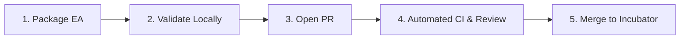

# 🤖 Berrytrade-EA

<p align="center">
  <strong>Institutional-Grade Open-Source Expert Advisors (EAs) & Quantitative Backtesting Framework for MetaTrader 5 (MQL5)</strong>
</p>

<p align="center">
  <a href="README.md"><strong>English</strong></a> | 
  <a href="README.zh-CN.md"><strong>简体中文</strong></a> | 
  <a href="wiki/Home.md"><strong>User Wiki</strong></a>
</p>

<p align="center">
  
  
  
  
  
</p>

---

## 📖 Overview

**Berrytrade-EA** is an open-source initiative dedicated to engineering high-quality, transparent, and reproducible algorithmic trading strategies (Expert Advisors) for **MetaTrader 5 (MT5)**.

Unlike traditional repositories that accumulate uncurated `.mq5` files without parameters or risk audits, **Berrytrade-EA** enforces:
- **Modular Packaging**: Every EA is a self-contained unit with source code, `.set` parameter presets, backtest reports, and structured metadata.
- **Strict Risk Governance**: Mandatory hard Stop-Loss enforcement. High-risk mechanics (such as Martingale or Uncapped Grid) are strictly quarantined and flagged.
- **Two-Tier Quality Funnel**: Community submissions enter `experimental/` for incubation, and graduate to `verified/` after passing standardized multi-year benchmark audits.
- **Automated Security CI**: Automated scanning prevents malicious Win32 DLL calls, telemetry backdoors, and broken schemas.

---

## 📚 Documentation System

We maintain a strict separation between technical and user-facing documentation:

| Category | Target Audience | Language | Location |
| :--- | :--- | :---: | :--- |
| **Developer Technical Docs** | Quant researchers, MQL5 developers, contributors | **English Only** | [`docs/developer/`](docs/developer/) |
| **User Wiki & Trader Guides** | Traders, end-users, operators | **Multi-Language (EN / 中文)** | [`wiki/`](wiki/) & GitHub Wiki |

- 🛠️ **Developer Docs**: [Architecture](docs/developer/architecture.md) &bull; [EA Ingestion Spec](docs/developer/ea-ingestion-specification.md) &bull; [Contribution Guidelines](docs/developer/contribution-guidelines.md) &bull; [Benchmarking Standards](docs/developer/benchmarking-standards.md)
- 📖 **User Wiki**: [Getting Started](wiki/Getting-Started.md) ([中文](wiki/Getting-Started-zh.md)) &bull; [Risk Management](wiki/Risk-Management.md) ([中文](wiki/Risk-Management-zh.md)) &bull; [Strategy Catalog](wiki/Strategy-Catalog.md) ([中文](wiki/Strategy-Catalog-zh.md)) &bull; [FAQ](wiki/Troubleshooting-and-FAQ.md) ([中文](wiki/Troubleshooting-and-FAQ-zh.md))

---

## 📑 Quantitative Research Papers (arXiv Format)

All strategies have undergone rigorous 3-year execution-constrained backtesting (2023--2025) and academic evaluation authored by **Berry Wahlberg** (`Berrytrade Quantitative Research`):

- 🏛️ **Master Synthesis Paper**: [*The Illusion of Alpha in Retail Algorithmic Trading: An Empirical Dissection of Indicator-Driven Expert Advisors and the Hidden Tail-Risk of Grid Overlays on MetaTrader 5*](papers/synthesis/main.pdf) ([LaTeX Source](papers/synthesis/main.tex))
- 📊 **Per-Strategy Research Reports**: Complete set of 14 standalone papers dissecting each strategy's microstructural mechanics and tail risk are indexed in [**`papers/README.md`**](papers/README.md).

---

## 📊 Strategy Catalog

The catalog below is dynamically generated from strategy `metadata.json` files:

### Verified Strategies (Production-Grade)

*No strategies currently in this tier (strict requirements: max drawdown $\le 20\%$, hard stop loss, zero unhedged grid).*

### Experimental Strategies (Incubator & Community)

| Strategy | Category | Risk Level | Symbols | TF | Min Cap | Summary |
| :--- | :--- | :---: | :--- | :---: | :---: | :--- |
| [2MAAOS](strategies/experimental/2MAAOS) | `trend_following` | **Extreme** | EURUSD, EURCAD, USDCAD | H4 | $10,000 | Dual Moving Averages and Andean Oscillator with Grid overlay. |
| [2MACDSTO](strategies/experimental/2MACDSTO) | `mean_reversion` | **Extreme** | NZDUSD | H3 | $10,000 | Dual MACDs and Stochastic Oscillator with Grid overlay. |
| [2MOMEMA](strategies/experimental/2MOMEMA) | `trend_following` | **High** | EURUSD | H1 | $1,000 | Dual Momentum and EMA trend filter strategy. |
| [3MACD](strategies/experimental/3MACD) | `scalping` | **Extreme** | AUDUSD | M5 | $10,000 | Triple MACD scalping strategy with Grid overlay. |
| [3MAF](strategies/experimental/3MAF) | `trend_following` | **Extreme** | USDCAD | M15 | $10,000 | Three Moving Averages and Williams Fractals with Grid overlay. |
| [AFAOSMD](strategies/experimental/AFAOSMD) | `trend_following` | **Extreme** | NZDCAD | M30 | $10,000 | Average Force, Andean Oscillator, and MACD with Grid overlay. |
| [BBRSI](strategies/experimental/BBRSI) | `mean_reversion` | **High** | XAUUSD | M5 | $1,000 | Bollinger Bands and RSI mean reversion strategy (supports controlled non-grid mode). |
| [CEZLSMA](strategies/experimental/CEZLSMA) | `trend_following` | **Extreme** | AUDUSD | M15 | $10,000 | Chandelier Exit and Zero Lag SMA (ZLSMA) with Grid overlay. |
| [COT1](strategies/experimental/COT1) | `trend_following` | **Medium** | EURUSD | Daily | $1,000 | Commitments of Traders (COT) report sentiment with SuperTrend indicator. |
| [DHLAOS](strategies/experimental/DHLAOS) | `scalping` | **Extreme** | AUDUSD | M5 | $10,000 | Daily High/Low and Andean Oscillator scalping with Grid overlay. |
| [LRCMACD](strategies/experimental/LRCMACD) | `trend_following` | **High** | EURUSD | H1 | $1,000 | Linear Regression Channel and MACD trend strategy. |
| [LRCUTB](strategies/experimental/LRCUTB) | `trend_following` | **Extreme** | AUDCAD | M15 | $10,000 | Linear Regression Candles and UT Bot alerts with Grid overlay. |
| [NWERSIASF](strategies/experimental/NWERSIASF) | `mean_reversion` | **Extreme** | USDCAD, AUDUSD, EURCHF | H2 | $10,000 | Nadaraya-Watson Envelope, RSI, and ATR Stop Loss Finder with Grid overlay. |
| [TemplateEA](strategies/experimental/TemplateEA) | `trend_following` | **Low** | XAUUSD, EURUSD | M5 | $1,000 | Standardized MQL5 EA template showcasing risk management, hard stop-loss, and modular structure. |

---

## 🏗️ Repository Layout

```text
Berrytrade-EA/
├── .github/                       # GitHub workflows, Issue & PR templates
├── docs/developer/                # Developer Technical Documentation (English only)
├── wiki/                          # User-Facing Documentation (Multi-Language, Wiki-ready)
├── strategies/                    # Self-contained EA packages
│   ├── verified/                  # Audited & benchmarked strategies
│   └── experimental/              # Community submissions & research models
│       └── <StrategyName>/
│           ├── src/               # EA source code (.mq5)
│           ├── presets/           # MT5 .set parameter presets
│           ├── reports/           # Backtest summary & tester reports
│           ├── metadata.json      # Machine-readable specification
│           └── README.md          # Strategy documentation
├── shared/                        # Shared libraries and reusable headers
│   ├── Include/Berrytrade/        # Namespaced risk & order utilities
│   ├── Indicators/                # Common technical indicators
│   └── Scripts/                   # Helper scripts
├── benchmarks/                    # Standardized testing environments & datasets
│   └── standards.json             # Baseline broker constraints (spreads, slippage)
├── tools/                         # Dev tools, CI linters, MT5 sync, Wiki publisher
│   ├── validate_ea.py             # Linter & metadata validator
│   ├── generate_catalog.py        # Automated README catalog generator
│   ├── sync_to_mt5.ps1            # Sync / symlink repo into MT5 terminal
│   └── publish_wiki.ps1           # Sync local wiki/ to GitHub Wiki
├── CONTRIBUTING.md                # Contributor guide entry point
├── LICENSE                        # MIT License
└── README.md                      # Primary project homepage
```

---

## 🚀 Quick Start: Deploying to MetaTrader 5

To install Berrytrade strategies and shared libraries into your local MT5 Terminal:

```powershell
# Run the deployment sync script
powershell ./tools/sync_to_mt5.ps1 -MT5DataPath "<YOUR_MT5_DATA_PATH>"
```

*Note: Your MT5 Data Directory can be found inside MetaTrader 5 by selecting **File -> Open Data Folder**.*

---

## 📥 EA Ingestion & Contribution Process

We welcome pull requests from traders and developers. All submissions must follow our four-step onboarding process:



1. **Package your EA**: Place your files in `strategies/experimental/<YourStrategyName>/` adhering to the required structure:
   - `src/<YourStrategyName>.mq5`
   - `presets/<PresetName>.set`
   - `reports/summary.json`
   - `metadata.json`
   - `README.md`
2. **Run Local Validation**:
   ```powershell
   python tools/validate_ea.py --path strategies/experimental/<YourStrategyName>
   ```
3. **Submit a Pull Request**: Use the repository's [PR Template](.github/PULL_REQUEST_TEMPLATE/pull_request_template.md) and ensure all checklist items are completed.
4. **Detailed Specifications**:
   - [EA Ingestion & Review Specification](docs/developer/ea-ingestion-specification.md)
   - [Developer Contribution Guidelines](docs/developer/contribution-guidelines.md)

---

## 🚨 Risk Disclaimer

**USE AT YOUR OWN RISK:** Trading financial instruments, forex, metals, and CFDs carries a high level of risk and may not be suitable for all investors. Leverage can work against you as well as for you.

- **Not Financial Advice**: The contents, strategies, indicators, and software in this repository are for educational, research, and algorithmic development purposes only. None of the content constitutes investment advice.
- **No Guarantees**: Past performance, backtest simulations, and historical data do not guarantee future trading results.
- **No Liability**: The maintainers, authors, and contributors of this repository bear no responsibility or liability for any financial losses or damages incurred through the use of this software.