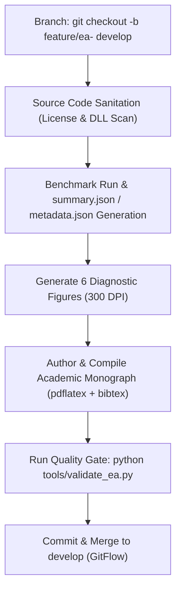

# AI Agent Operational Guidelines

> **Audience**: AI Coding Agents, Autonomous Pair-Programming Agents, and Quant Developers  
> **Language**: English (Developer documentation is exclusively maintained in English)  
> **Canonical Document**: [`AGENTS.md`](../../AGENTS.md)

---

## 1. Overview & Primary Mandates

This repository integrates autonomous AI agents (such as Google Antigravity, Claude, and GitHub Copilot) directly into the quantitative research and development workflow. All participating agents must strictly observe the operational contracts detailed in [`AGENTS.md`](../../AGENTS.md).

### Non-Negotiable Core Rules:
1. **Zero Access to Closed-Source Assets**: Under no circumstances may an agent inspect, index, copy, or reference `F:\dev\Berrytrade_onlyme` or any proprietary non-open-source directory.
2. **GitFlow Adherence**: No direct commits to `main`. All work must be conducted on feature branches created from `develop` and merged via small, atomic Pull Requests.
3. **No Win32 DLL Imports**: Native OS calls (`#import "user32.dll"`, `kernel32.dll`) are forbidden. All MQL5 logic must be pure native code.
4. **Reproducible Research**: Every newly ingested strategy must be backed by a 3-year execution benchmark (`2023--2025`), 6 Nature/Science 300 DPI diagnostic figures, and a complete LaTeX research monograph with verified BibTeX references.

---

## 2. Standardized Agent Execution Flow

For full details, reference the canonical specification in [**`AGENTS.md`**](../../AGENTS.md).
