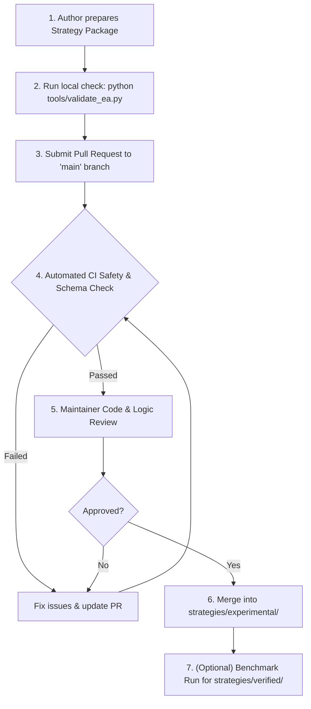

# EA Ingestion & Contribution Specification

> **Audience**: Quant developers, MQL5 engineers, and algorithmic traders submitting EAs to Berrytrade-EA.  
> **Language**: English (Developer documentation is exclusively maintained in English).

---

## 1. Strategy Quality Tiers

All strategies in the repository are segregated into two distinct tiers:

### 1.1 `experimental/` (Incubation & Community Tier)
- **Eligibility**: Open to all open-source community submissions.
- **Criteria**:
  - Valid MQL5 syntax and compiles without errors or warnings.
  - Passes automated security and metadata verification.
  - Includes at least one `.set` parameter file and an initial backtest report.
  - Complete strategy documentation explaining entry/exit conditions.
- **Purpose**: A discovery zone for novel ideas, new indicator combinations, and research prototypes.

### 1.2 `verified/` (Production & Benchmark Tier)
- **Eligibility**: Strategies that have demonstrated verified robustness and rigorous risk management.
- **Criteria**:
  - Backtested across at least 3 years of historical tick/1-minute data with modeled spreads and commissions.
  - Maximum equity drawdown $\le 20\%$ under recommended settings.
  - Profit Factor $\ge 1.30$ and trade sample size $\ge 200$ trades.
  - Must enforce hard Stop-Loss mechanisms (no naked positions without stops).
  - Walk-forward or out-of-sample stability verified.
  - Peer-reviewed by at least one core maintainer.

---

## 2. Risk Classification & Mandatory Disclosure

Every EA must declare its risk profile in its `metadata.json` and documentation.

| Category Tag | Strategy Class | Default Risk Level | Mandatory Disclosures |
| :--- | :--- | :---: | :--- |
| `trend_following` | Trend / Momentum | Low - Medium | Trailing stop rules, whipsaw behavior |
| `mean_reversion` | Bollinger / RSI / Channels | Medium | Range-breakout vulnerability |
| `breakout` | Support/Resistance / Volatility | Medium | False-breakout stop-loss rate |
| `scalping` | Low-timeframe M1/M5 | Medium - High | Execution latency & spread sensitivity |
| `grid` | Grid orders without multiplier | High | Maximum drawdown and basket close rules |
| `martingale` | Lot size multiplier on loss | **Extreme** | **Mandatory blown-account risk warning** |
| `arbitrage` | Latency / Statistical | High | Broker slippage & account ban warning |
| `news_trading` | High-impact calendar events | High | Slippage, spread widening, execution reject |

> [!WARNING]
> Strategies utilizing Martingale or Uncapped Grid methods **MUST** set `"risk_level": "Extreme"` and `"uses_martingale": true` in `metadata.json`. Submissions attempting to hide martingale logic will be closed immediately.

---

## 3. Package Structure Specification

Each EA must be contained within `strategies/{tier}/<StrategyName>/`:

```text
strategies/experimental/<StrategyName>/
├── src/
│   └── <StrategyName>.mq5          # Primary EA source file
├── presets/
│   └── Default_<Symbol>_<TF>.set   # Default parameter preset
├── reports/
│   ├── summary.json                # Summary metrics (JSON)
│   └── report.html                 # MT5 Strategy Tester report (optional but recommended)
├── metadata.json                   # Machine-readable specification
└── README.md                       # Comprehensive strategy guide
```

---

## 4. `metadata.json` Schema

The `metadata.json` file must conform to the following schema:

```json
{
  "$schema": "https://json-schema.org/draft/2020-12/schema",
  "name": "StrategyName",
  "version": "1.0.0",
  "author": "GitHubUsername",
  "license": "MIT",
  "category": "trend_following",
  "tier": "experimental",
  "risk_level": "Medium",
  "description": "Intraday trend-following strategy using EMA crossover and ATR trailing stop.",
  "supported_symbols": ["XAUUSD", "EURUSD"],
  "recommended_timeframe": "M5",
  "min_deposit_usd": 1000,
  "recommended_leverage": "1:100",
  "has_stop_loss": true,
  "uses_martingale": false,
  "uses_grid": false,
  "allows_overnight": false,
  "dependencies": {
    "includes": ["Berrytrade/Defines.mqh"],
    "indicators": []
  },
  "benchmark_summary": {
    "test_period": "2023.01.01 - 2025.12.31",
    "profit_factor": 1.45,
    "max_drawdown_percent": 11.2,
    "total_trades": 340,
    "win_rate_percent": 54.2
  }
}
```

---

## 5. Security & Prohibited Code Patterns

To protect the open-source community, any pull request containing the following will be **strictly rejected**:
1. **Unsafe Win32 / Native DLL Imports**: `#import "kernel32.dll"`, `user32.dll`, or custom external DLLs that may execute arbitrary code or compromise user machines.
2. **Obfuscated Code or Encrypted Payloads**: All code must be readable, plain-text MQL5 with clear algorithmic intentions.
3. **Phoning Home / Unauthorized Network Requests**: `WebRequest` calls to undocumented private servers, token exfiltration, or remote DRM activation.
4. **Account Stealers / Password Loggers**: Any attempt to read MT5 passwords, terminal paths, or send account balances to external webhooks without user opt-in.

---

## 6. PR & Ingestion Workflow



1. **Local Validation**: The contributor runs `python tools/validate_ea.py --path strategies/experimental/<StrategyName>` to ensure compliance.
2. **Submit PR**: Open a PR using the repository's Pull Request template, completing all checklist items.
3. **Automated Verification**: GitHub Actions runs the linter, schema validator, and security checks.
4. **Peer Review**: Maintainers and community members review the strategy code for quality, risk disclosure, and clarity.
5. **Merge**: Once approved, the strategy is merged into `strategies/experimental/` and the README catalog is automatically updated.
