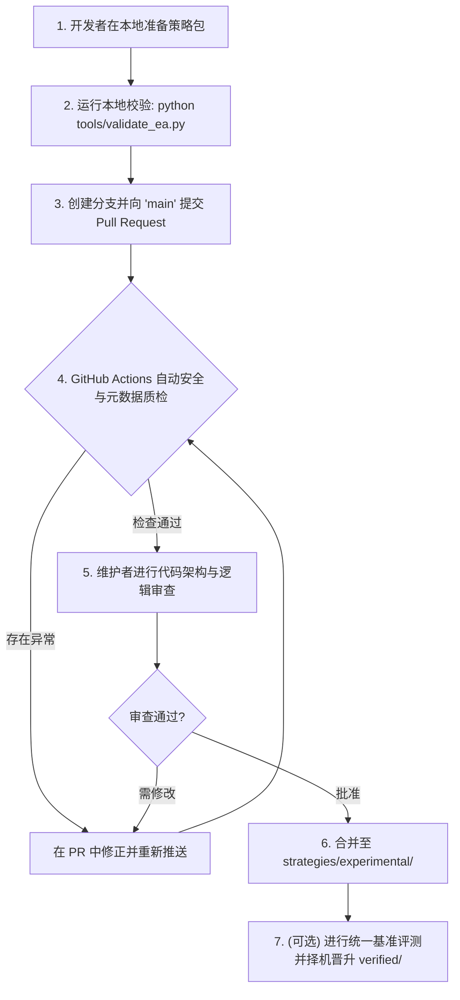

# EA 入库与贡献规范标准

本文档确立了 **Berrytrade-EA** 仓库关于交易 EA（智能交易系统）的入库标准、质量分级、安全合规及 PR（合并请求）审查流程。

---

## 1. 策略质量分级制度 (Tiers)

为了兼顾社区活跃度与策略可靠性，本仓库将所有策略划分为两个明确层级：

### 1.1 `experimental/`（孵化实验区 / 社区层）
- **准入门槛**：面向广大开源交易者与开发者的首发提交。
- **准入条件**：
  - MQL5 语法合规，在 MT5 最新稳定版中编译通过（无 Error，无严重 Warning）。
  - 通过自动化安全扫描与元数据校验（无恶意 DLL 调用、无远程后门）。
  - 附带至少一份可复现的 `.set` 参数文件与初始回测报告。
  - 具有规范的 `README.md`，清楚阐明入场出场逻辑与风控规则。
- **定位**：前沿思路碰撞、新型指标策略验证、社区协同迭代。

### 1.2 `verified/`（官方验证区 / 生产基准层）
- **晋升条件**（需满足硬性基准）：
  - 经受至少连续 3 年以上高质量 Tick / 1分钟历史数据回测（包含点差、隔夜利息及佣金摩擦成本）。
  - 推荐参数下最大净值回撤（Max Equity Drawdown）$\le 20\%$。
  - 获利因子（Profit Factor）$\ge 1.30$，有效交易样本数 $\ge 200$ 笔。
  - 严禁裸奔仓位，必须包含硬止损（Hard Stop-Loss）机制。
  - 具备样本外检验（Out-of-Sample / Walk-Forward）或蒙特卡洛压力测试记录。
  - 至少经由一位核心维护者进行白盒代码审计。

---

## 2. 策略风险分类与强制披露

每个策略必须在 `metadata.json` 及文档中如实声明风险分类与风控特征。

| 分类标识 (`category`) | 策略类别 | 默认风险等级 | 强制披露项 |
| :--- | :--- | :---: | :--- |
| `trend_following` | 趋势跟踪 / 动量 | 中低 | 震荡市磨损、移动止损规则 |
| `mean_reversion` | 均值回归 / 通道振荡 | 中 | 假突破单边行情防范 |
| `breakout` | 突破交易 / 波动率突破 | 中 | 假突破止损率、挂单有效性 |
| `scalping` | 超短线 / 剥头皮 (M1/M5) | 中高 | 点差敏感度、滑点容忍度与网络延迟要求 |
| `grid` | 等距/非加倍网格策略 | 高 | 最大持仓网格数、浮亏清仓保护机制 |
| `martingale` | 逆势加倍马丁格尔 | **极高 (Extreme)** | **必须显式标红：有穿仓/爆仓风险！** |
| `arbitrage` | 统计套利 / 延迟套利 | 高 | 经纪商限制、滑点与执行拒单预警 |
| `news_trading` | 突发重大新闻/数据交易 | 高 | 点差急剧扩大、流动性黑洞与滑点风险 |

> [!WARNING]
> 任何使用逆势倍投（Martingale）或无上限网格（Uncapped Grid）的策略，**必须**在 `metadata.json` 中明确设置 `"risk_level": "Extreme"` 和 `"uses_martingale": true`。隐藏此类高风险逻辑的提交将直接被拒并不予合并。

---

## 3. 策略包目录规范 (Package Layout)

每个策略在提交时，必须以独立子目录形式存放于 `strategies/{tier}/<StrategyName>/`：

```text
strategies/experimental/<策略英文名>/
├── src/
│   └── <策略英文名>.mq5           # EA 核心主源码
├── presets/
│   └── Default_<品种>_<周期>.set   # MT5 参数预设文件
├── reports/
│   ├── summary.json               # 关键回测数据摘要 (JSON)
│   └── report.html                # MT5 官方回测测试报告 (推荐附带)
├── metadata.json                  # 机器可读元数据描述
└── README.md                      # 策略说明文档 (必须包含英文，支持中文对照)
```

---

## 4. `metadata.json` 规范

提交的 `metadata.json` 必须满足以下字段定义：

```json
{
  "$schema": "https://json-schema.org/draft/2020-12/schema",
  "name": "StrategyName",
  "version": "1.0.0",
  "author": "GitHubUsername",
  "license": "MIT",
  "category": "trend_following",
  "tier": "experimental",
  "risk_level": "Medium",
  "description": "基于 EMA 均线交叉与 ATR 动态跟踪止损的日内黄金/外汇策略。",
  "supported_symbols": ["XAUUSD", "EURUSD"],
  "recommended_timeframe": "M5",
  "min_deposit_usd": 1000,
  "recommended_leverage": "1:100",
  "has_stop_loss": true,
  "uses_martingale": false,
  "uses_grid": false,
  "allows_overnight": false,
  "dependencies": {
    "includes": ["Berrytrade/Defines.mqh"],
    "indicators": []
  },
  "benchmark_summary": {
    "test_period": "2023.01.01 - 2025.12.31",
    "profit_factor": 1.45,
    "max_drawdown_percent": 11.2,
    "total_trades": 340,
    "win_rate_percent": 54.2
  }
}
```

---

## 5. 安全红线与禁止代码模式

为维护社区环境与用户资金安全，凡包含以下行为的代码一律 **严禁合并**：
1. **危险原生 Win32 / DLL 导入**：严禁 `#import "kernel32.dll"`、`user32.dll` 或未知外部 DLL 调用（防范内存注入及恶意执行）。
2. **代码混淆与加密 Payload**：所有提交必须为清晰、无混淆的纯文本 MQL5 源码。
3. **未授权网络通信与后门**：严禁私自通过 `WebRequest` 向未公开第三方服务器上报数据、下发未审计远程控制指令或抓取用户敏感凭据。
4. **账户隐私嗅探**：严禁嗅探、记录用户的终端交易密码、主账户连接秘钥或进行未经用户授权的外传。

---

## 6. PR 入库流程与审核步骤



1. **本地校验**：贡献者在提交前运行 `python tools/validate_ea.py --path strategies/experimental/<策略名>` 确保无格式与安全阻断。
2. **发起 PR**：使用 GitHub PR 模板完整填写策略概述、回测依据与风控承诺。
3. **自动化 CI 流水线**：系统自动校验目录规范、JSON Schema 及恶意代码模式。
4. **人工代码审查**：核心维护者针对代码可读性、交易逻辑安全、止损完备性进行审查。
5. **正式合并**：合并后，自动化脚本将新策略元数据同步渲染至主页策略索引总表。
